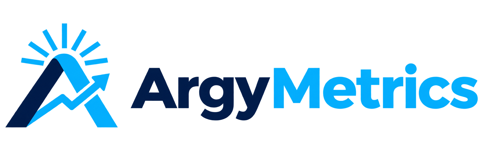

# ArgyMetrics

<p align="center">
  
</p>

<p align="center">
  <strong>El pulso financiero de Argentina, en una sola pantalla.</strong><br />
  Cotizaciones, indicadores y contexto de mercado con una interfaz clara y rápida.
</p>

**Dashboard financiero en tiempo real para Argentina y mercados globales.**

[](https://argymetrics.vercel.app/)
[](https://nextjs.org/)
[](https://www.typescriptlang.org/)
[](./LICENSE)

---

## Datos en vivo

| Categoria | Fuente | Revalidacion |
|---|---|---|
| Divisas (Blue, Oficial, MEP, CCL, Cripto, Tarjeta, Euro, Real) | DolarAPI | 0s (always fresh) |
| Inflacion oficial (IPC), salario real, EMAE, canastas, IPC regional y pobreza | INDEC API | 6 h / 24 h |
| Real en billeteras (Mercado Pago, Belo, Lemon, AstroPay, etc.) | ComparaPix | 2 min |
| Riesgo Pais, Reservas BCRA | Ambito / BCRA | 2 min |
| Criptomonedas (BTC, ETH) | Yahoo Finance | 1 min |
| Commodities (Oro, Brent, Gas Natural) | Yahoo Finance | 5 min |
| Acciones Argentinas (11 empresas BYMA) | Yahoo Finance | 5 min |
| Acciones Internacionales (7 empresas NASDAQ/KRX) | Yahoo Finance | 5 min |
| Indices (Merval, S&P 500, Nasdaq, Dow Jones) | Yahoo Finance | 5 min |
| Billeteras Virtuales (AstroPay, Lemon, Belo, Ripio, Fiwind, etc.) | CriptoYa | 1 min |
| Monedas LATAM (MXN, COP, UYU, PEN, CLP, PYG) | DolarAPI / ER-API | 1 min |

## Experiencia del producto

- **Economía real**: salario real contra IPC, actividad económica (EMAE), canasta básica, pobreza e inflación por región, con datos oficiales del INDEC.
- **Real en billeteras**: cotizaciones PIX de Mercado Pago, Belo, Lemon, AstroPay y otras billeteras, con precio para pagar y para cobrar.
- **Otras monedas**: MXN, COP, UYU, PEN, CLP y PYG en el panel principal y en el conversor.
- **Comparador histórico**: contrasta Dólar Blue, MEP, Riesgo País e Inflación en períodos de 7, 30, 90 días, 1 año o un rango personalizado.
- **Lectura relativa base 100**: permite comparar tendencias con unidades distintas sin perder los valores nominales.
- **Valores reales en contexto**: el gráfico muestra el dato porcentual y el valor monetario, en puntos o porcentual según la serie; el resumen incluye inicio, final, diferencia y variación.
- **Vista de tarjetas personalizable**: elegí entre diseño compacto, clásico o detallado y forma suave, circular o recta. La preferencia se guarda en el navegador.
- **Dashboard responsive**: navegación y comparador optimizados para escritorio, tablet y móvil, con soporte de tema claro y oscuro.
- **Identidad completa**: lockups horizontal y apilado, isotipo, favicon, íconos PWA, Open Graph y metadata estructurada para buscadores y redes.

Para probar el comparador localmente, iniciá el proyecto con `pnpm dev`, abrí [http://localhost:3000/comparador](http://localhost:3000/comparador) o seleccioná **Comparador** en el navbar.

## Sistema de marca

| Asset | Uso |
|---|---|
| `logo/logo-horizontal.png` | Navbar, README y superficies principales |
| `logo/logo-stacked.png` | Footer y composiciones verticales |
| `logo/icon-master.png` | Hero del dashboard y navegación móvil |
| `logo/icon-16x16.png` a `logo/icon-512x512.png` | Favicon, Apple touch icon y PWA |
| `logo/og-image-white.png` | Open Graph y tarjetas sociales |

## Acciones

### Internacionales (NASDAQ / KRX)
`AAPL` Apple · `NVDA` Nvidia · `MSFT` Microsoft · `SAMSUNG` Samsung · `TSLA` Tesla · `SPCX` SpaceX · `MU` Micron

### Argentinas (BYMA)
`GGAL` Grupo Galicia · `YPFD` YPF · `PAMP` Pampa Energia · `BMA` Banco Macro · `CEPU` Central Puerto · `TXAR` Ternium · `ALUA` Aluar · `CRES` Cresud · `TGSU2` TGS · `LOMA` Loma Negra · `MELI` Mercado Libre

## Arquitectura

- **Server-first**: React Server Components, zero client-side fetching
- **Typescript estricto**: sin `any`, tipos unificados en `lib/types/index.ts`
- **API layer**: toda la logica de fetching en `lib/api/`, nunca en componentes
- **ISR caching**: `fetch({ next: { revalidate } })` por fuente de datos
- **Safe fallbacks**: API errors devuelven `null`, `[]`, `0` — nunca crashea SSR
- **Logos locales**: 18 logos corporativos servidos desde `/public/logos/` (SVG + PNG), sin dependencias externas
- **Comparador híbrido**: datos históricos en Server Components y controles/gráficos interactivos aislados en el cliente

## Stack

| Tecnologia | Uso |
|---|---|
| Next.js 16 (App Router) | Framework, SSR, ISR |
| TypeScript 5 | Tipado estricto |
| Tailwind CSS v4 | Dark mode, responsive |
| Recharts 3 | Sparklines + graficos historicos |
| Lucide React | Iconos |
| DolarAPI / ArgentinaDatos / INDEC / ComparaPix / Yahoo Finance / CriptoYa | Fuentes de datos |

## Desarrollo local

```bash
git clone https://github.com/Fontanacx/argymetrics.git
cd argymetrics
pnpm install
pnpm approve-builds --all
pnpm dev
```

Abre [http://localhost:3000](http://localhost:3000).

### Variables de entorno

La API del INDEC requiere un JWT. Creá un archivo `.env.local` (ya está ignorado por git) con:

```bash
INDEC_API_TOKEN=tu_token
```

El token se usa solo del lado del servidor. Si falta o la API falla, la inflación cae a ArgentinaDatos y el resto de los indicadores del INDEC se ocultan sin romper el dashboard.

### Regenerar logos corporativos

```bash
pwsh scripts/download-logos.ps1
```

## Estructura del proyecto

```
lib/
  types/index.ts          Tipos TypeScript unificados
  api/                    modulos de fetching (dollars, stocks, crypto, indec, etc.)
  constants/              Configuracion, tickers, labels, revalidacion
  formatters/             currency.ts, date.ts, metrics.ts
  utils/                  insights.ts, semaforo.ts, briefing-generator.ts
app/
  components/dashboard/   Server Components (DollarCard, StockCard, IndexCard, etc.)
  components/HistoricalComparison.tsx  Comparador histórico interactivo
  components/charts/      SparklineChart (Recharts)
  components/layout/      Navbar, Footer, MarketTicker, SectionHeader
  components/ui/          VariationBadge, Skeletons
  components/modals/      InfoButton, IndicatorDetail, Modal
  components/insights/    Panel de insights diarios
  page.tsx                Dashboard principal
public/logos/             18 logos corporativos (SVG + PNG)
logo/                     Identidad ArgyMetrics, íconos y recursos sociales
scripts/                  download-logos.ps1
```

## Licencia

MIT. Los datos provistos son de caracter informativo y no constituyen asesoramiento financiero.

## Validación

```bash
pnpm exec tsc --noEmit
pnpm build
```
